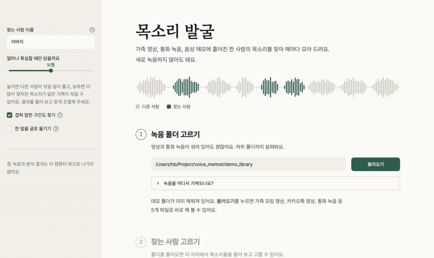
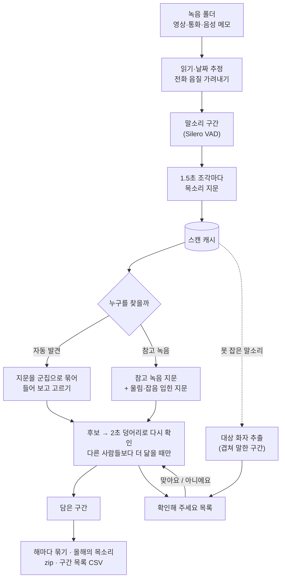
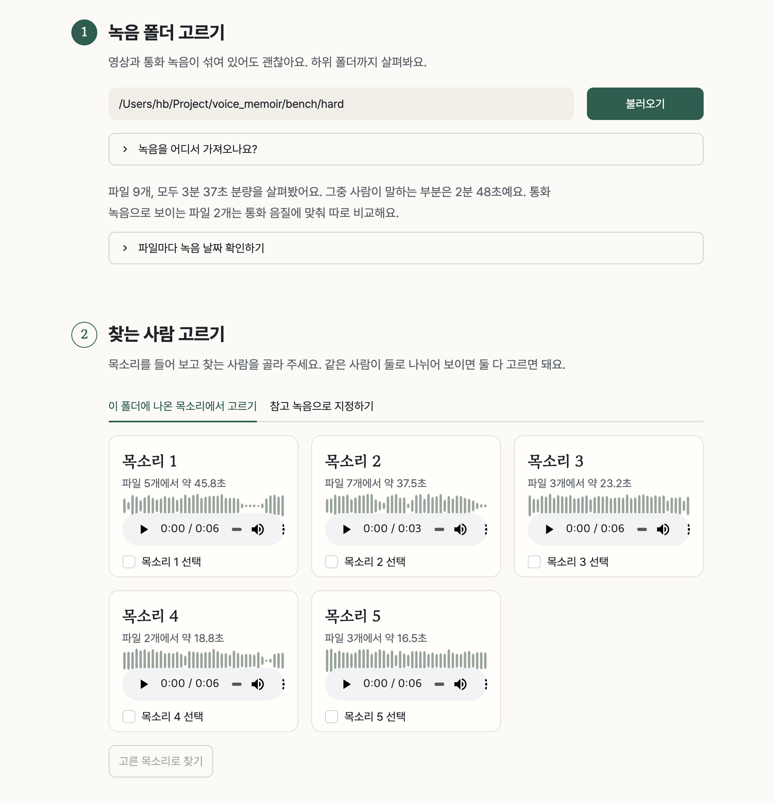
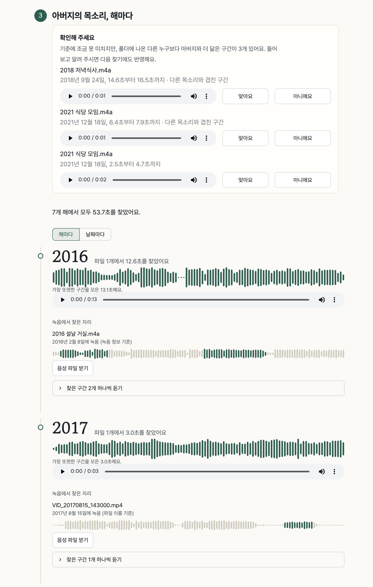
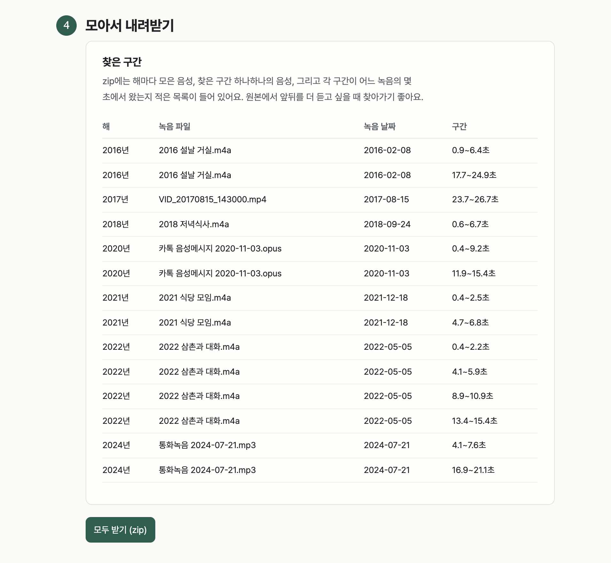

# 목소리 발굴

흩어진 녹음(가족 영상·통화 녹음·음성 메모)에서 한 사람의 목소리만 찾아 해마다 모아 주는 로컬 앱.
돌아가셨거나 투병 중이라 새로 녹음할 수 없는 부모님의 목소리를, 이미 가진 녹음에서 되찾는 상황을 겨냥했다.
분석은 모두 이 컴퓨터 안에서 하고, 녹음은 밖으로 보내지 않는다.



## 한눈에

| | |
|---|---|
| 문제 | 가족 녹음에는 여러 사람 목소리, TV 소리, 식당 소음, 통화 음질이 섞여 있다. 몇 년 치 녹음을 사람이 일일이 들으며 한 사람 목소리만 골라내기는 어렵다. |
| 방법 | 말소리를 1.5초 조각으로 나눠 조각마다 '목소리 지문'(화자 임베딩)을 뽑고, 찾을 사람 지문과 비교한다. 목소리가 닮은 가족이 섞이지 않도록 폴더에 나온 다른 사람들과도 비교해, 그 누구보다 확실히 더 닮은 조각만 담는다. |
| 한국어 | 공개 모델 9개를 한국어로 비교해 바탕 모델을 고르고, 한국인 95명의 음성에 소음·울림을 입혀 추가 학습했다. 집 GPU 서버(GTX 1070)에서 학습했다. |
| 겹쳐 말하기 | 두 사람이 동시에 말한 구간은 '대상 화자 추출' 모델로 찾을 사람 목소리만 뽑아 다시 확인하고, 사람에게 확인받는다. 이 모델도 한국어로 추가 학습했다. |
| 검증 | 누가 몇 초에 말했는지 정답이 있는 합성 시험 세트 4종(학습에 쓰지 않은 소음·울림·화자, 함정 녹음 포함)과 **실제 회의 녹음**(AMI, 같은 네 사람이 다른 날 네 번 회의, 12명). 자동 시험 63개. |
| 한계 | 실제 녹음 검증은 영어 회의 녹음이다. 한국어 실제 가족 녹음으로는 아직 검증하지 않았다(녹음에 Audacity로 표시만 하면 재는 도구 `tools/evaluate_real.py`는 준비됨). |

**주요 결과** (합성 시험 세트, 학습에 쓰지 않은 소음·울림·화자)

| 항목 | 한국어 학습 전 | 학습 후 |
|---|---|---|
| 시끄러운 식당(0dB)에서 같은 사람·다른 사람을 헷갈린 비율, 낭독 10명 | 19.2% | **8.5%** |
| 같은 조건, 실제 강연 40명(다른 녹음 환경) | 25.0% | **15.7%** |
| 식당 대화에서 찾을 사람 말소리를 찾은 비율(자동 발견, 10명) | 54% | **82%** |
| 두 사람이 겹쳐 말한 대화에서 찾은 비율(참고 녹음 + 사람 확인) | 72% | **82%** |
| 찾을 사람이 5dB 작게 겹친 대화 | 44% | **64%** |
| 찾을 사람이 없는 함정 녹음에서 잘못 담은 시간 | 0초 | **0초** |

**실제 회의 녹음** (AMI, 원거리 마이크 하나, 12명이 둘째~넷째 회의에서 말한 4.4시간. 찾은 비율 / 담은 것 중 다른 사람 목소리)

| 방식 | 처음 | 고친 뒤 |
|---|---|---|
| 참고 녹음 10초 | 10% / 0.8% | **41% / 1.2%** |
| 참고 녹음 + '같은 사람인가요?'에 답함 | 36% / 1.1% | **49% / 1.4%** |
| 자동 발견(그 사람 목소리 묶음을 고름) | 61% / 0.9% | **61% / 1.0%** |

담은 것의 99% 안팎이 찾는 사람이다. 실제 녹음에서 드러난 문제(한 사람이 목소리 묶음 수십~백여 개로 쪼개짐)와 고친 방법은 아래 '실제 녹음 검증'에 있다.

'헷갈린 비율'(EER)은 같은 사람 쌍을 다르다고 하는 비율과 다른 사람 쌍을 같다고 하는 비율이 같아지는 지점의 값이다. 100쌍 중 몇 쌍을 틀리는지로 읽으면 되고, 낮을수록 좋다.

## 작동 흐름



| 단계 | 하는 일 | 왜 이렇게 했나 |
|---|---|---|
| 1. 폴더 스캔 | 영상까지 포맷 상관없이 읽고, 날짜는 녹음 정보 → 파일 이름 → 파일 시각 순으로 추정해 근거와 함께 보여 준다. 전화 음질 녹음은 따로 가려낸다. | 가족 녹음은 기기·앱마다 형식과 날짜 기록 방식이 다르다. |
| 2. 말소리 조각 지문 | 말소리를 1.5초 창으로 0.75초씩 밀며 지문을 뽑아 캐시에 둔다. | 한 구간에 여러 사람이 섞일 수 있어, 화자가 바뀌는 곳을 0.75초 단위로 따라가려고. |
| 3. 누구를 찾을지 | 자동 발견(목소리 군집을 들어 보고 고름) 또는 참고 녹음 하나. | 돌아가신 분은 깨끗한 참고 녹음이 없을 수 있다. |
| 4. 두 단계 찾기 | 1.5초 조각으로 후보를 넉넉히 잡고, 2초 덩어리로 다시 확인한다. 폴더의 다른 목소리들(경쟁자)보다 확실히 더 닮아야 담는다. | 짧은 조각 점수는 들쭉날쭉해 닮은 가족을 잘못 잡기 쉽다. 경쟁자 비교가 닮은 삼촌을 거르는 핵심 장치다. |
| 5. 겹친 구간 | 못 잡은 말소리 중 조금이라도 닮은 곳은 대상 화자 추출로 찾을 사람 목소리만 뽑아 다시 확인하고, 통과하면 확인 목록에 올린다. 바로 담지는 않는다. | 겹친 구간 지문은 두 목소리가 섞여 어느 쪽과도 덜 닮는다. |
| 6. 사람 확인 | 기준에 조금 못 미치지만 다른 누구보다 더 닮은 구간을 묻는다. '맞아요'는 기준 지문에, '아니에요'는 경쟁자에 더해 다시 찾는다. | 기계가 애매한 곳은 사람이 들으면 바로 안다. |
| 7. 해마다 모으기 | 해마다 가장 또렷한 구간을 30초 안쪽으로 묶은 '올해의 목소리', 구간별 음성, 출처 목록(CSV)을 zip으로 받는다. | 원본의 몇 초에서 왔는지 남겨 앞뒤를 다시 찾아 들을 수 있게. |

녹음이 진짜인지 증명하는 기능과 목소리 높이 분석은 뺐다. 원본이 조작되지 않았는지 알 수 없고, 몇 초짜리 녹음의 목소리 높이는 기기와 환경에 따라 달라져 보증하기 어렵기 때문이다.

## 화면

어려운 시험 세트(9개 녹음, 2016~2025년)를 불러와 목소리를 고르고 찾은 모습. 파형에서 초록은 찾는 사람, 회색은 다른 사람이다.

| 폴더 불러오기와 목소리 고르기 | 해마다 찾은 목소리와 확인 목록 |
|---|---|
|  |  |



화면과 맨 위 장면은 `tools/screenshots.py`, `tools/demo_gif.py`가 헤드리스 크롬으로 실제 앱을 눌러 가며 찍었다.

## 실행

```bash
python3.13 -m venv .venv && .venv/bin/pip install -r requirements.txt
.venv/bin/streamlit run app.py          # 화면 (http://localhost:8501)
```

명령줄로도 같은 과정을 돌릴 수 있다. 목소리 번호는 폴더마다 다르니 먼저 목록을 본다.

```bash
.venv/bin/python cli.py ~/가족녹음                                   # 폴더에 나오는 목소리 보기(샘플 저장)
.venv/bin/python cli.py ~/가족녹음 --pick 4 --person 아버지           # 고른 목소리로 해마다 모으기
.venv/bin/python cli.py ~/가족녹음 --reference 참고.m4a --person 아버지
.venv/bin/python cli.py ~/가족녹음 --pick 4 --transcribe             # 받아쓰기 포함(선택)
```

결과는 `exports/`에 `이름_연도_올해의목소리.wav/.m4a`와 `이름_구간목록.csv`로 저장된다.

화자 지문 모델은 세 가지 중 고른다. 한국어 학습 모델은 내려받을 곳이 없어 아래 '다시 만들기'대로 직접 학습해야 하고, 없으면 학습 전 모델로 돈다.

| `VM_MODEL` | 모델 | 라이선스 |
|---|---|---|
| (기본) `voxblink2_samresnet34_ko` | SimAM-ResNet34 한국어 학습판. 가장 정확함 | 비상업(바탕 모델 학습 데이터 조건) |
| `ecapa_ko` | ECAPA-TDNN 한국어 학습판 | 상업 이용 가능(출처 표기) |
| `voxblink2_samresnet34_ft` / `ecapa` | 학습 전 공개 모델(첫 실행 때 자동 내려받기) | 비상업 / Apache-2.0 |

```bash
VM_MODEL=ecapa_ko .venv/bin/streamlit run app.py
```

## 자동 시험

```bash
.venv/bin/pip install -r requirements-dev.txt
.venv/bin/python -m pytest          # 약 1분
```

- 모델 없이 도는 시험 58개: 소리 값으로 화자를 정하는 가짜 엔진으로 찾기 흐름 전체(후보 → 덩어리 확인 → 경쟁자 비교 → 겹친 구간 → 사람 확인 반영)를 돌리고, 쪼개진 묶음 합치기, 참고 녹음의 '확실히 같은 사람 따라가기', 녹음이 길어져도 들어 볼 구간 고르기가 느려지지 않는지, 쓰다 끊긴 캐시에서 다시 계산하는지, 날짜 추정, 해마다 묶기, CSV, 추출 모델 캐시, 실제 녹음 채점을 확인한다.
- 실제 모델로 도는 시험 5개: 어려운 세트에서 정확도가 기록보다 떨어지지 않는지, 함정 녹음에서 아무것도 담지 않는지, 엄격하게 할수록 잘못 담는 시간이 늘지 않는지, 화면을 처음부터 끝까지 눌러 봐도 오류가 없는지, 스캔 작업자 프로세스가 화면 파일을 다시 실행하지 않는지, 작업자가 죽어도 스캔이 이어지는지. 가중치나 시험 세트가 없으면 건너뛴다.

## 실제 녹음으로 재기

합성 시험 세트 대신 실제 가족 녹음으로 재려면, 녹음마다 찾을 사람이 말한 곳을 표시한 정답 파일을 옆에 둔다.
Audacity로 녹음을 열어 구간을 끌어 잡고 Ctrl+B로 레이블을 단 뒤 '레이블 내보내기'를 하면 된다(화자 분리 연구에서 쓰는 RTTM도 읽는다).
찾을 사람이 없는 녹음은 빈 정답 파일을 둔다.

```bash
.venv/bin/python tools/evaluate_real.py ~/가족녹음 --reference 참고.m4a
.venv/bin/python tools/evaluate_real.py ~/가족녹음 --auto
```

공개 실제 녹음으로 재려면(아래 '실제 녹음 검증'):

```bash
.venv/bin/python tools/fetch_data.py ami          # AMI 회의 12개와 정답(약 0.7GB)
.venv/bin/python tools/evaluate_ami.py --all-levels
```

## 화자 지문 모델

### 바탕 모델 고르기

공개 모델 9개를 한국어로 시험했다(`tools/korean_sv.py`, Zeroth-Korean 테스트 세트의 한국인 10명·문장 457개). 같은 사람과 다른 사람을 헷갈린 비율:

| 모델 | 문장 전체 | 2초 조각 | 2초 + 나쁜 음질 |
|---|---|---|---|
| ECAPA-TDNN (VoxCeleb) | 0.6% | 3.2% | 10.4% |
| CAM++ 중·영 (3D-Speaker) | 0.5% | 1.4% | 8.6% |
| **SimAM-ResNet34 (VoxBlink2 미세조정판)** | **0.1%** | **1.1%** | **7.4%** |

깨끗한 문장은 영어 위주로 학습한 모델도 거의 틀리지 않는다. 차이는 앱이 실제로 판단하는 짧고 음질 나쁜 조각에서 벌어진다(나머지 모델은 `bench/korean_sv_round1.txt`).
앱에 넣어 보면 CAM++는 많이 찾는 대신 닮은 삼촌과 TV 소리를 2~4배 더 담아서(`bench/compare_models_round1.txt`, `bench/tune_campplus.txt`) SimAM-ResNet34를 골랐다.

모델마다 '닮은 정도' 숫자 크기가 달라, 한국어 2초 조각에서 다른 사람끼리 그 점수 이상이 나오는 비율이 ECAPA와 같아지는 값으로 모든 기준값을 바꿨다(`tools/calibrate.py`, 예: ECAPA 0.45 → 0.578).

### 한국어 추가 학습

`tools/finetune.py`. 학습 전 모델이 깨끗한 2초 조각에서 뽑은 지문을, 같은 조각에 소음·웅성거림·방 울림·전화 음질을 입혀도
그대로 뽑도록 가르치고(지문 공간을 원래 모델과 같게 유지), 한국인 화자끼리 구분하는 학습을 조금 더했다. 앞쪽 층은 고정하고 뒤쪽 층만 학습했다.

- 학습 데이터: Zeroth-Korean 학습 세트 105명 중 95명(10명은 검증용으로 뺌), 51.7시간
- 학습에 입힌 소리: RIRS_NOISES의 시뮬레이션 방 울림 6만 개와 점 소음 843개, 학습 화자 3~6명을 겹친 웅성거림, 전화 음질
- 시험에 쓴 소리(학습에 안 씀): DEMAND 실제 녹음 소음(카페·식당·거실·광장·버스), 실측 방 울림 325개
- 시험 화자(학습에 안 씀): Zeroth 테스트 10명(낭독), Pansori-TEDxKR 40명(실제 강연, 다른 녹음 환경)

**학습에 안 쓴 소음·울림에서** 헷갈린 비율 (`tools/condition_sv.py`, 깨끗한 2초 ↔ 조건 입힌 2초, `bench/server/condition_sv_ko.txt`)

| 조건 | 낭독(Zeroth) 학습 전 → 후 | 실제 강연(Pansori) 학습 전 → 후 |
|---|---|---|
| 깨끗함 | 1.1% → 0.9% | 7.7% → 6.4% |
| 카페 5dB | 4.7% → 1.9% | 11.1% → 7.9% |
| 식당 0dB | 19.2% → 8.5% | 25.0% → 15.7% |
| 거실 5dB | 2.3% → 1.4% | 8.8% → 7.1% |
| 멀리서(실측 울림) | 3.2% → 1.5% | 9.7% → 7.5% |
| 멀리서 + 광장 5dB | 5.9% → 2.5% | 12.8% → 9.2% |

전체 층 학습과 더 시끄러운 조건을 넣은 학습도 해 봤다. 낭독 말뭉치의 시끄러운 조건에서는 조금 나았지만, 실제 강연 말뭉치에서 비슷하거나 못했고
앱 전체에서 잘못 담는 시간이 늘어 뒤쪽 층만 학습한 모델을 골랐다(`bench/server/condition_sv_ko2.txt`, `ko3.txt`, `eval_cond_ko2.txt`, `ko3.txt`).
기준값은 환산값에서 다섯 단계를 한 칸씩 엄격하게 옮겼다. 조건별 세트에서 찾는 양은 거의 같고 잘못 담는 시간이 1/3~1/5로 줄었다.
참고 녹음과 '확실히 같은 사람'으로 볼 기준(0.76)은 시험 세트에서 다른 사람 목소리가 참고 녹음과 가장 닮게 나온 값(0.74)보다 조금 위로 정했고, 그 아래 애매한 목소리는 사람에게 묻는다.

### 상업용: ECAPA 한국어 학습

기본 모델은 바탕 모델의 학습 데이터(VoxBlink2) 때문에 비상업으로만 쓸 수 있다. 서비스용으로는 상업 이용이 되는 ECAPA-TDNN(Apache-2.0)을
같은 방법으로 학습했다(`tools/finetune.py --base ecapa`, 전체 층, 6회차, `bench/server/finetune_ecapa_ko.txt`). 학습 데이터도 모두 상업 이용이 된다.

| 시험 | ECAPA 학습 전 | **ECAPA 한국어 학습** | 기본 모델(비상업) |
|---|---|---|---|
| 헷갈린 비율: 2초 조각 | 3.2% | **2.0%** | 0.9% |
| 헷갈린 비율: 2초 + 나쁜 음질 | 10.1% | **5.9%** | 2.9% |
| 헷갈린 비율: 식당 0dB, 낭독 | 18.5% | **11.0%** | 8.5% |
| 헷갈린 비율: 식당 0dB, 실제 강연 | 22.3% | **20.0%** | 15.7% |
| 조건별 세트, 참고 녹음 | 78% / 0.5초 | **88% / 0.5초** | 90% / 1.1초 |
| 조건별 세트, 자동 발견 | 85% / 3.9초 | **91% / 2.4초** | 95% / 2.2초 |
| 어려운 세트, 참고 녹음 / 자동 발견 | 66% / 1.2초, 62% / 1.2초 | **72% / 1.1초, 75% / 1.7초** | 75% / 1.7초, 73% / 1.7초 |
| 실제 회의(AMI), 참고 / 참고+확인 / 자동 | | **23% / 46% / 65%** | 41% / 49% / 61% |

(`bench/server/korean_sv_ecapa_ko.txt`, `condition_sv_ecapa_ko.txt`, `final_cond_ecapa_ko.txt`, `eval_hard_ecapa_ko_final.txt`, `eval_cond_ecapa_base_v2.txt`, `final_ami_ecapa_ko.txt`)

앱 전체로는 잘못 담은 시간이 같거나 줄면서 찾는 양이 늘었고, 시끄러운 식당 대화에서 차이가 가장 컸다(참고 녹음 34% → 61%, 자동 발견 48% → 74%).
헷갈린 비율은 낭독체에서는 크게 줄었지만 실제 강연(다른 녹음 환경)에서는 조금 줄었다.
기준값은 후보를 잡는 기준은 환산한 가운데 단계(0.338) 그대로 두고, 담는 기준만 한 칸 엄격하게(0.489 → 0.539) 옮겼다. 앱에서 '조금 엄격하게'를 고를 때와 같은 방식이다.
환산값 그대로 쓸 때와 비교해 찾는 양은 거의 같고(참고 88% → 88%, 자동 93% → 91%) 잘못 담는 시간은 0.9 → 0.5초, 4.6 → 2.4초로 줄었다(`eval_cond_ecapa_ko_level2.txt` → `final.txt`).
후보 기준까지 같이 올리면 2초 덩어리 경계가 바뀌어 참고 방식에서 잘못 담는 시간이 2.0초로 늘었다(`eval_cond_ecapa_ko_v2.txt`). 이 값들은 조건별 세트를 보고 정했다.

겹쳐 말하기 세트(`eval_overlap_ecapa_ko_final.txt`)에서는 추출 + 확인으로 겹친 대화 85% / 91%, 작게 겹친 대화 71% / 84%(참고 / 자동)를 찾아 기본 모델보다 많았다.
다만 자동 방식에서 함정 녹음 하나에 2.0초를 잘못 담았다. 고른 목소리 묶음 중 작은 묶음 두 개에 다른 사람(A) 목소리가 20~25% 섞여 있었고,
A와 B가 겹친 2초가 그 기준을 넘었다(`trap_diag_ecapa_ko.txt`). 이 모델은 한 사람을 더 많은 묶음으로 나눠(평균 4.6개, 기본 모델 3.3개) 이런 섞인 묶음이 생기기 쉽다.
'같은 사람인가요?'로 묻는 목소리는 10명에 10개로 기본 모델(5개)보다 많다.

실제 녹음 검증에서 기본 모델에 넣은 '쪼개진 묶음 합치기'와 '확실히 같은 사람 따라가기'는 이 모델에서는 끈다(`calibration.json`의 `merge`, `chain`).
켜 보니 실제 회의에서는 더 찾았지만(참고 57%, 자동 66%) 합성 세트에서 다른 사람까지 이어 붙어, 조건별 세트 참고 방식에서 63초,
겹쳐 말하기 함정에서 22.7초를 잘못 담았다(`bench/server/ecapa_ko_merge_chain_on_*.txt`). 이 모델의 '확실히 같은 사람' 기준(0.64)이
같은 사람과 다른 사람 묶음을 충분히 가르지 못하는 것으로 보인다.

### 겹쳐 말하기 (대상 화자 추출)

`vm/tse.py`. ESPnet의 TD-SpeakerBeam(영어 LibriMix로 학습한 공개 가중치, CC BY 4.0)을 ESPnet 없이 돌도록 옮기고(원본과 출력 차이 0),
한국어 화자 95명을 겹쳐 섞은 소리로 추가 학습했다(`tools/finetune_tse.py`, 12회차). 찾을 사람 4초에 다른 사람 1~2명(−6~+6dB, 일부만 겹치기도 함)을 섞고,
30%는 방 울림, 30%는 소음을 입혔다(학습용 소리만). 학습에서 뺀 화자 10명으로 잰 목소리 뽑기 품질(SI-SNR 향상)은 5.4dB → 8.1dB.

**겹침 시험** (`tools/overlap_bench.py`, 시험 화자 10명, 4초 섞기 가운데 2초를 앱과 같은 기준으로 판정)

| 조건 | 섞인 소리 그대로 | 공개 가중치로 추출 | 한국어 학습한 추출 |
|---|---|---|---|
| 깨끗함, 같은 세기 | 45.0% | 88.3% | **89.2%** |
| 깨끗함, 찾을 사람이 5dB 작음 | 5.0% | 78.3% | **86.7%** |
| 방 울림 + 카페 소음, 같은 세기 | 27.5% | 29.2% | **50.8%** |
| 방 울림 + 카페 소음, 5dB 작음 | 3.3% | 16.7% | **34.2%** |
| 찾을 사람 없이 둘이 겹침(잘못 만든 비율) | 0.0% | 0.8% | 0.8% |

**앱 전체** (`bench/overlap/`, `tools/evaluate_overlap.py`, 10명 합계. 찾은 비율 / 잘못 담은 시간. '확인'은 확인 목록을 사람이 맞게 답했다고 가정)

| 녹음 | 참고 방식: 확인만 | 참고 방식: 추출 + 확인 | 자동 방식: 확인만 | 자동 방식: 추출 + 확인 |
|---|---|---|---|---|
| 조용한 대화 | 100% / 0초 | 100% / 0초 | 100% / 0초 | 100% / 0초 |
| 겹친 대화(같은 세기, 절반·완전 동시) | 71% / 0초 | **82%** / 0.4초 | 74% / 0초 | **85%** / 0.4초 |
| 작게 겹친 대화(5dB 작음) | 44% / 0.3초 | **64%** / 0.9초 | 44% / 0.2초 | **70%** / 1.2초 |
| 함정(찾을 사람 없이 겹침) | 0초 | 0초 | 0초 | 0초 |

확인 목록에 올라오는 구간은 10명에 49~59개였고, 그중 찾을 사람이 아닌 것은 없었다(`bench/server/final_overlap_ko.txt`).
깨끗한 겹침에서는 공개 가중치와 비슷하고(`bench/server/eval_overlap_pretrained.txt`), 방 울림이 있을 때 한국어 학습이 크게 낫다.
사람 확인이 없으면 이 구간은 담기지 않는다.

음성 분리(SepFormer-WHAMR)는 완전히 동시에 말한 구간을 살리지 못해 넣지 않았다(`bench/server/sep_test.txt`).
추출 후보로 삼을 '닮은 정도' 하한을 올리면 추출 횟수는 줄지만 찾는 양도 같이 줄어(`bench/server/eval_overlap_floors.txt`) 가장 많이 찾는 값을 쓰고,
같은 구간은 다시 뽑지 않도록 결과를 캐시에 둔다. 추출은 4초에 맥 GPU 0.5초, CPU 1.2초이고, 말소리 1시간이면 맥 GPU로 약 3분이 더 걸린다.
화면 왼쪽 "겹쳐 말한 구간도 찾기"로 끌 수 있고, 전화 음질 녹음은 추출 모델이 학습하지 않은 조건이라 건너뛴다.

### 다시 만들기

GPU가 있는 컴퓨터에서(학습 데이터 약 10GB):

```bash
python tools/fetch_data.py demo train test tse      # 공개 데이터를 원래 출처에서 받기
python tools/prep_zeroth.py                         # 학습용 파일로 풀기
python tools/finetune.py --train-from layer3 --batch 32 --epochs 2 --out voxblink2_samresnet34_ko
python tools/finetune.py --base ecapa --epochs 6 --batch 32 --lr 5e-5 --out ecapa_ko
python tools/calibrate.py ecapa_ko && python tools/same_person_stats.py ecapa_ko --write   # 기준값
python tools/finetune_tse.py                         # 대상 화자 추출(ESPnet이 깔린 환경)
```

학습은 회차마다 저장하고 `--resume`으로 이어 간다. 학습 서버(Proxmox 가상 머신에 GPU를 넘겨 씀)가 오래 쉬지 않고 학습하면
통째로 멈춘 일이 있어서, 한 회차씩 돌리고 사이에 5분 쉬게 했다.

## 시험 세트와 정확도

정답(누가 몇 초에 말했는지)이 있는 세트로 잰다. 모두 실제 사람 녹음을 이어 붙이고 조건을 입힌 합성 세트다.

| 세트 | 만드는 도구 | 내용 |
|---|---|---|
| 데모 `demo_library/` | `tools/make_demo_library.py` | 5개 녹음 3분 18초: 실내 잡음, 영상, 통화 음질, 찾을 사람이 없는 녹음, 날짜 근거 세 가지 |
| 어려운 세트 `bench/hard/` | `tools/make_hard_benchmark.py` | 9개 녹음 3분 37초: TV 켜진 거실, 멀리서 울리는 영상, 겹쳐 말하기, 8kbps 메신저 음성, 시끄러운 식당, 닮은 삼촌과 2초씩 주고받기, 압축된 통화, 함정 2개 |
| 조건별 세트 `bench/cond/` | `tools/make_cond_benchmark.py` | Zeroth 테스트 화자 10명 × 7조건(조용한 방, 카페 5dB, 식당 0dB, 거실 TV, 멀리서, 멀리서+광장, 함정). 학습에 안 쓴 소음·울림만 |
| 겹쳐 말하기 세트 `bench/overlap/` | `tools/make_overlap_benchmark.py` | 10명 × 4개(조용한 대화, 겹친 대화, 작게 겹친 대화, 함정) |

데모·어려운 세트의 찾을 사람은 만든 사람 본인 목소리 33.8초를 쪼갠 것이고(저장소에 넣지 않음, 없으면 공개 한국어 화자로 대신 만든다),
삼촌·사촌 역할은 찾을 사람과 목소리가 가장 닮은 공개 화자를 일부러 골랐다.

**어려운 세트**, 기본 기준, 문장 사이 쉼을 뺀 말소리 기준 (`python tools/evaluate.py --set hard [--model ...]`)

| 방식 | 한국어 학습 모델(기본) | 학습 전(VoxBlink2) | ECAPA 한국어 학습 | ECAPA 학습 전 |
|---|---|---|---|---|
| 참고 녹음 7초 | **75% / 1.7초** | 66% / 0.7초 | 72% / 1.1초 | 66% / 1.2초 |
| 자동 발견 | **73% / 1.7초** | 66% / 0.7초 | 75% / 1.7초 | 62% / 1.2초 |

(`bench/eval_hard_ko_v2.txt`, `bench/eval_hard_voxblink2_samresnet34_ft_v2.txt`, `bench/eval_hard_ecapa_v2.txt`, `bench/server/eval_hard_ecapa_ko_final.txt`)
한국어 학습으로 찾는 양은 늘었지만 이 작은 세트에서는 잘못 담은 시간도 0.7초 → 1.7초로 늘었다. 늘어난 1초는 시끄러운 식당 녹음에서
문장 사이 쉼을 함께 담은 것이다(웅성거림이 파일 내내 깔려 있어 쉼도 잘못 담음으로 센다). 함정 녹음 두 개에서는 모든 모델이 0초다.

**조건별 세트**, 10명 합계, 기본 기준 (`tools/evaluate_cond.py`, `bench/server/final_cond_ko.txt`, 학습 전은 `bench/server/eval_cond_ft_base_v2.txt`). 찾은 비율 / 잘못 담은 시간

| 조건 | 참고 녹음 | 참고 + '같은 사람인가요?' 답함 | 자동 발견 | 자동 발견, 학습 전 |
|---|---|---|---|---|
| 조용한 방 | 100% / 0초 | 100% / 0초 | 100% / 0초 | 100% / 0초 |
| 카페 5dB | 97% / 0.1초 | 98% / 0.1초 | 98% / 0.1초 | 96% / 0.1초 |
| 식당 0dB | 75% / 0초 | 81% / 0초 | 82% / 0초 | 54% / 0초 |
| 거실 TV | 84% / 0.6초 | 84% / 0.6초 | 87% / 3.5초 | 87% / 3.6초 |
| 멀리서 | 99% / 0초 | 99% / 0초 | 98% / 0초 | 100% / 0초 |
| 멀리서 + 광장 | 98% / 0.1초 | 98% / 0.1초 | 98% / 0.1초 | 93% / 0.1초 |
| 함정(찾을 사람 없음) | 0초 | 0초 | 0초 | 0초 |

참고 녹음 방식에서 "같은 사람인가요?"로 물은 목소리는 10명에 5개였다. 실제 녹음 검증 뒤 넣은 묶음 합치기 때문에 자동 발견의 거실 TV에서 잘못 담은 시간이 2.0초 → 3.5초로 늘었다(나머지는 같거나 나아짐, `bench/server/eval_cond_ecapa_ko_level2.txt`와 비교).

- 속도(83분 분량 첫 스캔, `bench/speed_round2.txt`): 기본 모델은 맥 GPU로 약 2분 30초(실시간의 33배), ECAPA는 약 57초(88배). 두 번째 스캔부터는 캐시로 바로 읽는다.
- 사람 확인 효과는 `tools/review_sim.py`로 흉내 냈다.

## 실제 녹음 검증 (AMI 회의)

합성 세트만으로는 실제 녹음에서 어떻게 동작하는지 알 수 없어서, 누가 언제 말했는지 정답이 있는 공개 실제 녹음으로 쟀다.
한국어 대화 녹음 중에는 화자 정답이 붙어 있고 바로 받을 수 있는 것을 찾지 못해, 영어 회의 말뭉치 AMI(CC BY 4.0)를 썼다.
한국어 학습의 효과가 아니라 '실제 대화를 방 가운데 마이크 하나로 녹음한 조건'에서 앱이 어떻게 동작하는지를 보는 시험이다.

| 항목 | 내용 |
|---|---|
| 녹음 | 시험 분할의 세 모임(ES2004, IS1009, TS3003). 모임마다 같은 네 사람이 다른 날 네 번 회의, 회의당 20~40분, 방 가운데 마이크(Array1-01) |
| 찾을 사람 | 12명을 한 명씩. 한 모임의 네 회의를 '녹음 폴더' 하나로 본다 |
| 참고 녹음 | 첫 회의에서 그 사람만 말한 구간 10초 남짓 |
| 자동 발견 | 그 사람 말이 절반 넘게 든 목소리 묶음을 모두 고른다(사람이 들어 보고 고르는 상황 흉내) |
| 채점 | 참고 녹음을 자른 첫 회의는 빼고 나머지 세 회의(찾을 사람 말소리 4.4시간). 정답 경계 앞뒤 0.25초 제외 |

처음 재 보니 자동 발견은 61%를 찾았지만 참고 녹음 방식은 10%에 그쳤다(`bench/server/eval_ami_ko.txt`). 원인은 두 가지였다.

1. **한 사람이 목소리 묶음 수십~백여 개로 쪼개졌다.** 네 사람 회의 네 번에서 묶음이 157~276개 나왔다(합성 세트에서는 한 사람이 1~3개).
   멀리서 녹음한 긴 회의에서는 같은 사람의 1.5초 조각끼리도 덜 닮기 때문이다.
2. **참고 녹음 방식은 참고 녹음과 '확실히 같은' 묶음만 같은 사람으로 보고 나머지는 경쟁자로 둔다.** 쪼개진 자기 묶음 대부분이 경쟁자가 되어
   자기 목소리를 막았다.

그래서 두 가지를 넣었다. 둘 다 이미 쓰던 '확실히 같은 사람' 기준(same_person_sure)을 그대로 써서 새로 맞춘 숫자는 없다.

- **쪼개진 묶음 합치기**: 묶음 대표 지문끼리 평균 닮은 정도가 그 기준을 넘으면 합친다(`_merge_fragments`). 묶음 수 702개 → 424개.
- **확실히 같은 사람 따라가기**: 참고 녹음과 확실히 같은 묶음과 확실히 같은 묶음도 같은 사람으로 본다(`SURE_CHAIN`).

방법을 고를 때는 저장한 묶음 대표 지문으로 합치는 방법 세 가지(average, complete, single)를 먼저 흉내 내고(같은 사람 묶음 수, 다른 사람이 섞이는 비율),
후보 두 가지를 실제 회의와 합성 세트 모두에서 쟀다(`bench/server/merge_*`, `chain_*`, `sc_*`).

| 방식 (찾은 비율 / 담은 것 중 다른 사람) | 처음 | 합치기만 | 합치기 + 따라가기(지금) |
|---|---|---|---|
| 참고 녹음 10초 | 10% / 0.8% | 15% / 0.9% | **41% / 1.2%** |
| 참고 + '같은 사람인가요?'에 답함 | 36% / 1.1% | 34% / 1.1% | **49% / 1.4%** |
| 자동 발견 | 61% / 0.9% | 61% / 1.0% | **61% / 1.0%** |

(`bench/server/merge_none_ami.txt`, `merge_average_0_ami.txt`, `final_ami_ko.txt`)
합성 세트에서는 조건별 세트 참고 방식이 90% → 93%로 나아졌고, 겹쳐 말하기·어려운 세트·데모는 거의 같았으며, 함정 녹음은 모두 0초를 지켰다.
나빠진 것은 조건별 세트 자동 발견의 거실 TV(잘못 담은 시간 2.0초 → 3.5초) 하나다.

**단계별** (`final_ami_ko.txt`, 화면의 '얼마나 확실할 때만 담을까요'): 찾은 비율 / 담은 것 중 다른 사람

| 방식 | 넉넉하게 | 조금 넉넉하게 | 보통(기본) | 조금 엄격하게 | 엄격하게 |
|---|---|---|---|---|---|
| 참고 녹음 | 44% / 1.8% | 43% / 1.5% | 41% / 1.2% | 36% / 0.9% | 27% / 0.7% |
| 참고 + 확인 | 53% / 2.1% | 52% / 1.8% | 49% / 1.4% | 42% / 1.0% | 31% / 0.9% |
| 자동 발견 | 73% / 1.6% | 69% / 1.4% | 61% / 1.0% | 42% / 0.6% | 21% / 0.4% |

부모님 목소리 모음에 다른 사람 목소리가 섞이지 않는 쪽을 기본으로 두었다. 실제 회의에서는 한 단계 넉넉하게 해도 다른 사람이 2% 안쪽이라,
녹음이 길고 멀리서 녹음된 경우에는 넉넉하게 고르는 편이 낫다.

**아직 남은 문제**: 합친 뒤에도 실제 회의에서는 한 사람이 묶음 9~84개(가운데 35개 안팎)로 나뉜다. 자동 발견으로 몇 시간짜리 녹음 폴더를 다루면
사람이 들어 보고 골라야 할 목소리 카드가 많다. 참고 녹음 방식에서 묻는 '같은 사람인가요?'는 한 사람에 0~15개였다.
짧은 대답(1초 미만)은 일부러 담지 않는데, 실제 회의 말소리에서 5% 정도다.

## 아직 못 하는 것과 확인하지 못한 것

- **한국어 실제 가족 녹음**: 실제 녹음 검증은 영어 회의 녹음(같은 사람이 며칠에 걸쳐 녹음됨)으로만 했다. 몇 년에 걸친 목소리 변화, 서로 다른 휴대폰, 한국어 가족 대화에서의 성능은 아직 모른다. 녹음에 표시만 하면 재는 도구(`tools/evaluate_real.py`)는 준비해 두었다. 기준값 몇 개(한 단계 엄격하게, '확실히 같은 사람' 0.76)는 합성 시험 세트를 보고 정했다.
- **긴 녹음에서 목소리 묶음이 많다**: 몇 시간짜리 실제 녹음에서는 한 사람이 수십 묶음으로 나뉘어, 자동 발견으로 고를 카드가 많다(위 '실제 녹음 검증').
- **두 사람이 동시에 말하는 구간**: 확인 목록에서 사람이 '맞아요'를 눌러야 담긴다. 찾을 사람이 5dB 작게 말하고 방 울림까지 있으면 대상 화자 추출로도 34%만 살린다.
- **시끄러운 식당(0dB)**: 조건별 세트에서 75~82%를 찾는다. 울림만 걷어내는 처리(WPE)는 효과가 작아 넣지 않았다(`bench/condition_sv_wpe.txt`).
- **라이선스**: 가장 정확한 기본 모델은 비상업이다. 상업용 ECAPA 한국어 모델은 조건별 세트에서 비슷하지만 화자 구분 시험에서는 덜 정확하고,
  자동 발견에서 다른 사람이 섞인 목소리 묶음을 고르면 그 사람 목소리를 담을 수 있다(겹쳐 말하기 세트 함정 1건, 2.0초).
- **개인정보**: 음성은 생체정보에 해당할 수 있다. 부모님처럼 다른 사람의 목소리를 다룰 때의 동의 절차는 제품 단계에서 설계해야 한다.

## 구조

```
app.py                 화면 (Streamlit)
visual.py              화면용 파형 그림(회색 = 다른 사람, 초록 = 찾는 사람)과 스타일
cli.py                 명령줄
vm/audio.py            디코딩, 날짜 추정, 전화 음질 감지·변환
vm/engine.py           말소리 구간 검출(Silero VAD), 화자 지문 모델 목록·기준값, 장치 선택(cuda → mps → cpu)
vm/samresnet.py        SimAM-ResNet34 모델 정의(WeSpeaker에서 옮김)
vm/augment.py          조건 지문용 울림·잡음·압축·통화 음질 입히기
vm/library.py          폴더 스캔(여러 작업자)과 캐시
vm/speakers.py         자동 발견, 참고 녹음 등록, 경쟁자 비교, 두 단계 찾기, 겹친 구간, 사람 확인 반영
vm/tse.py              대상 화자 추출(TD-SpeakerBeam, ESPnet에서 옮김)
vm/timeline.py         해마다 묶기, 올해의 목소리, 구간 목록
vm/transcribe.py       받아쓰기(faster-whisper, 선택)
tests/                 자동 시험(pytest)
tools/                 시험 세트 만들기, 평가, 모델 비교, 기준값 환산, 한국어 추가 학습, 데이터 받기, 화면 캡처
bench/                 정답 파일과 측정 기록(bench/server/는 GPU 서버에서 잰 것)
```

구현 메모
- 스캔 캐시는 임시 파일에 쓴 뒤 바꿔 넣고, 읽다가 오류가 나면 지우고 다시 계산한다. 쓰는 도중 컴퓨터가 멈춰 빈 파일이 남으면 그 폴더를 계속 못 읽는 일을 막는다.
- 엄격한 단계도 후보는 기본 단계만큼 넉넉히 잡는다. 후보 기준을 같이 올리면 2초 덩어리 경계가 옮겨 가, 엄격하게 했는데 닮은 가족을 더 담는 일이 생긴다.
- 확인 목록에서 '이미 담긴 구간과 겹친다'며 뺄 때는 절반 넘게 겹친 것만 뺀다. 겹쳐 말한 구간은 담긴 구간 바로 옆에 붙어 있기 쉽다.
- 목소리마다 들어 볼 구간은 대표 조각 앞뒤 8초 안에서 고른다. 예전처럼 파일 전체를 찾으면 몇 시간짜리 녹음에서 목소리 나누기가 끝나지 않았다.
- Streamlit은 화면 파일을 `__main__`으로 돌려, 스캔 작업자 프로세스(spawn)를 띄우는 동안만 `__main__`을 빈 모듈로 바꿔 둔다. 작업자가 죽으면 남은 파일은 이 프로세스에서 계산한다.
- torch 2.12 CPU에서 ECAPA 지문을 배치 16개 이상으로 뽑으면 100배 넘게 느려져 CPU는 배치 8로 고정했다. SpeechBrain 1.1은 처음부터 맥 GPU로 불러오면 오류가 나서 CPU로 불러온 뒤 옮긴다.
- WeSpeaker 패키지를 통째로 불러오면 지금 torchaudio와 맞지 않는 모듈까지 따라와서 모델 정의만 옮겼다(원본과 출력 차이 0.0000006 이하).
- 스캔 작업자는 수학 라이브러리 스레드를 하나로 묶어야 서로 코어를 뺏지 않는다.
- 화면 글꼴(고운바탕, 프리텐다드)은 인터넷이 될 때 CDN에서 받아 온다. 글꼴만 받아 올 뿐 녹음이나 분석 결과는 보내지 않는다.

## 출처

가져다 쓴 코드·모델·데이터와 라이선스는 [THIRD_PARTY_NOTICES.md](THIRD_PARTY_NOTICES.md)에 있다. 데이터는 `tools/fetch_data.py`로 원래 출처에서 받고 저장소에는 넣지 않는다.
